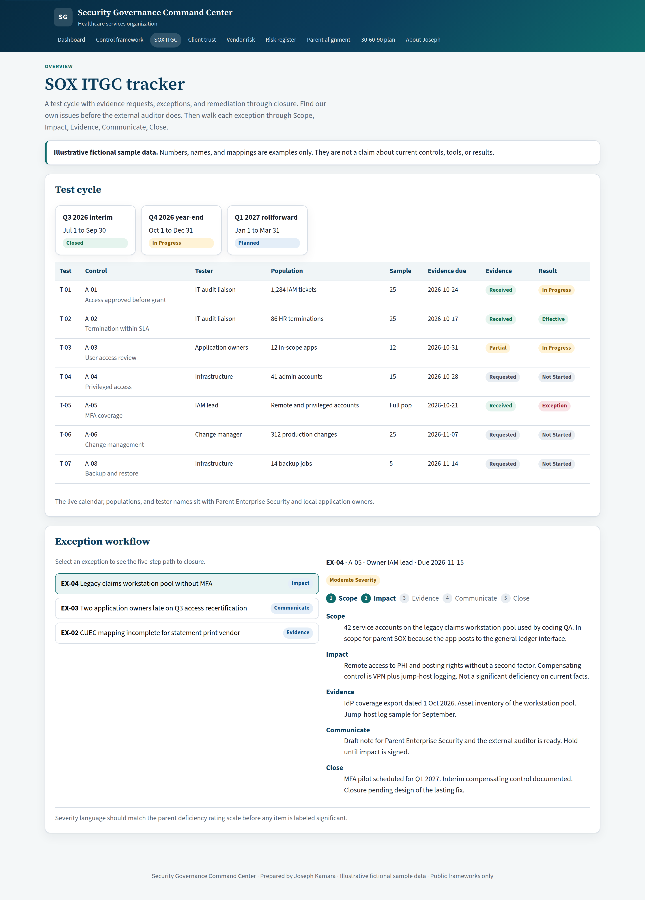
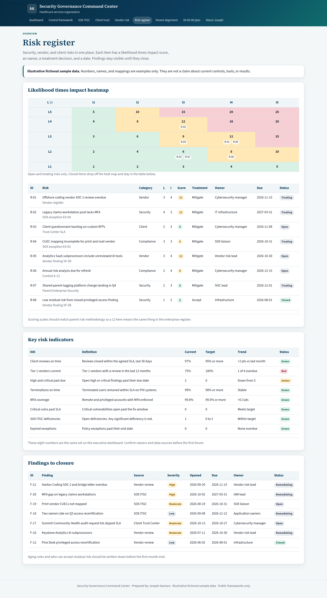
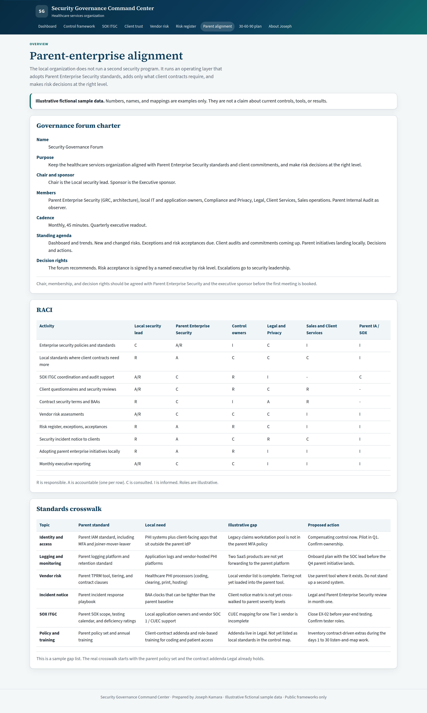
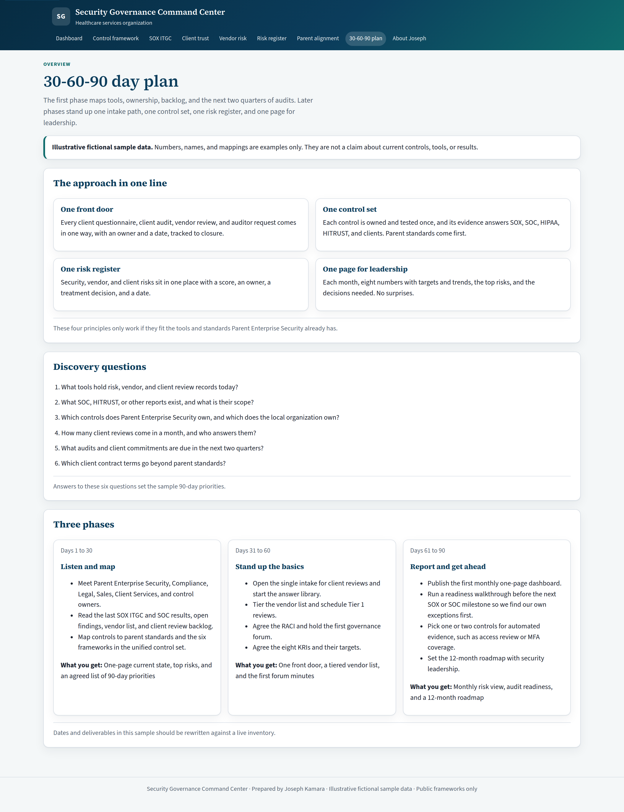

# Security Governance Command Center

A static Vite + React portfolio project by **Joseph Kamara, CPA, CISA, CISSP**. It is a sample security governance workspace for a healthcare services organization and its parent enterprise.

All numbers, vendors, clients, and findings are **illustrative fictional sample data**. They are built from public frameworks (SOX ITGC, SOC 2, HIPAA Security Rule, NIST CSF 2.0, ISO 27001:2022, and public HITRUST CSF numbering). HITRUST IDs should be checked against the licensed version before anyone treats them as an official crosswalk.

This repository is public-safe. It does not name real employers or clients. There are no API keys, tokens, or `.env` files. Source PDFs and private notes are excluded from git.

Public home: [github.com/Josephkamara/security-governance-command-center](https://github.com/Josephkamara/security-governance-command-center).

## Run locally

```bash
npm install
npm run dev
```

The app listens on [http://127.0.0.1:4521](http://127.0.0.1:4521).

```bash
npm run build    # writes static files to dist/
npm run preview  # serves dist/ on the same port
```

There is no backend and no secrets. Hash routing (`/#/controls`) keeps GitHub Pages and other static hosts simple.

## Publish to GitHub Pages

The workflow in `.github/workflows/pages.yml` builds `dist/` on each push to `main`. Set Pages to GitHub Actions (Settings → Pages → Source).

```bash
git remote add public https://github.com/Josephkamara/security-governance-command-center.git
git push -u public main
```

Do not copy private source documents or notes.

## What is in the command center

| Route | Module | Contents |
| --- | --- | --- |
| `/#/` | Executive dashboard | One page with 8 KRIs, trends, top risks, and a printable board summary |
| `/#/controls` | Unified control framework | One control, one owner, one evidence set mapped across six frameworks |
| `/#/sox` | SOX ITGC tracker | Test cycle, evidence requests, exceptions, Scope-Impact-Evidence-Communicate-Close |
| `/#/client-trust` | Client security trust center | SIG Lite / HECVAT library, SLA tracker, due-diligence intake |
| `/#/vendor-risk` | Vendor risk | 4-tier model, inherent-risk calculator, 7-step intake, SOC checklist, remediation |
| `/#/risk-register` | Risk register | Likelihood x impact heatmap, KRIs, findings to closure |
| `/#/parent-alignment` | Parent-enterprise alignment | Forum charter, RACI, standards crosswalk with Parent Enterprise Security |
| `/#/30-60-90` | 30-60-90 plan | Map current state, stand up the basics, report and plan the next year |
| `/#/about` | About Joseph | How the modules relate to his experience, without employer names |

## Module walkthrough

**Executive dashboard.** A one-page leadership view with eight KRIs, each with a target, a trend, and a status. It also lists top open risks and includes a printable board-style summary.

**Unified control framework.** A searchable matrix that maps one owner and one evidence set across SOX ITGC, SOC 2, the HIPAA Security Rule, NIST CSF 2.0, ISO 27001:2022, and public HITRUST numbering. The idea is to test once and reuse the proof.

**SOX ITGC tracker.** Follows a sample test cycle, evidence requests, and exceptions through a five-step close path: Scope, Impact, Evidence, Communicate, Close.

**Client security trust center.** A SIG Lite / HECVAT-style answer library tied to controls, plus a turnaround SLA tracker and a due-diligence intake queue.

**Vendor risk.** A four-tier model with an inherent-risk calculator, a seven-step intake, a SOC report checklist that includes bridge letters and CUECs, and a remediation list.

**Risk register.** Combines security, vendor, and client items on one likelihood times impact heatmap, with the same eight KRIs and a findings-to-closure view.

**Parent-enterprise alignment.** A sample governance forum charter, a RACI, and a standards crosswalk that treats Parent Enterprise Security as the source of the standard.

**30-60-90 plan.** A three-phase outline: map the current state, stand up intake and the first forum, then publish a first dashboard and a 12-month roadmap.

**About.** Background on Joseph Kamara and how the modules relate to IT audit, SOX ITGC program work, hospital-system audit, and vendor-risk reviews.

## Screenshots

Illustrative sample screens from a local run. Open the live app for the interactive pieces (search, exception workflow, vendor scorer, print). To regenerate screenshots after a UI change, run `npm i --no-save puppeteer-core` and `node scripts/capture-screenshots.mjs` with the preview server up.












## Design and quality notes

- Healthcare-professional palette (navy and teal), serif headings, plain language.
- Responsive layout with a mobile menu. Keyboard-visible focus and a skip link.
- Dashboard print stylesheet hides navigation and produces a board-style one-pager.
- No authentication, database, or environment variables.

## Author

Joseph Kamara, CPA, CISA, CISSP  
[linkedin.com/in/joseph-kamara](https://www.linkedin.com/in/joseph-kamara)
