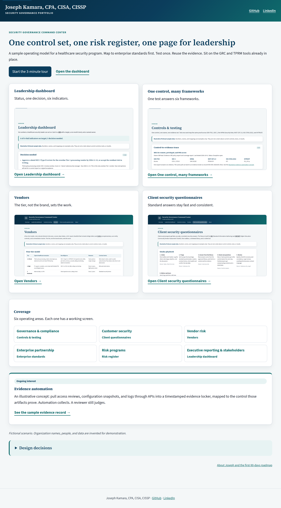
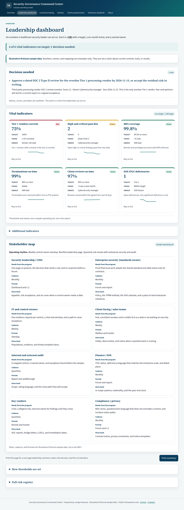
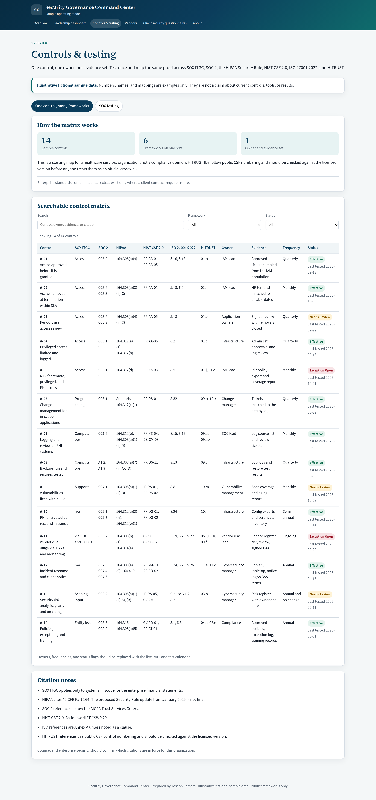
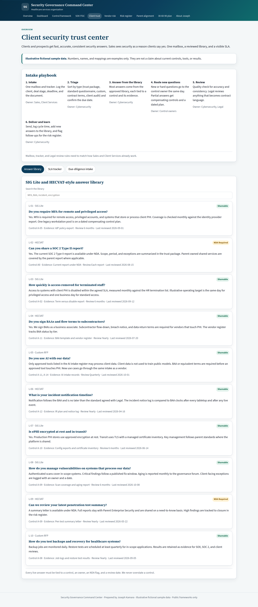
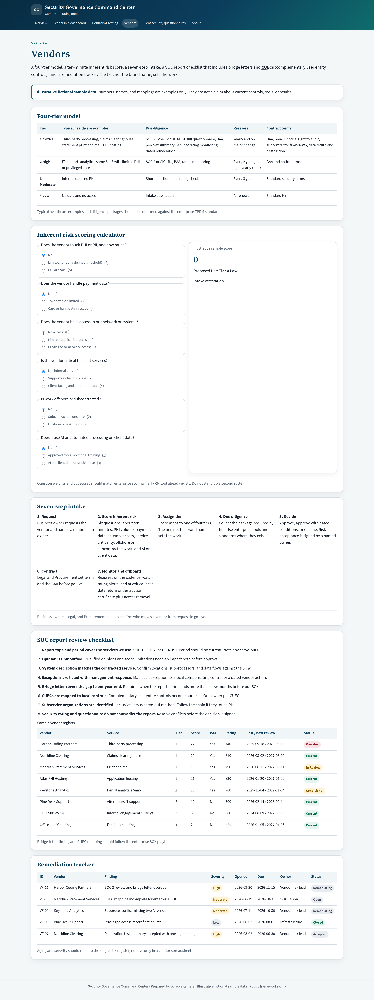
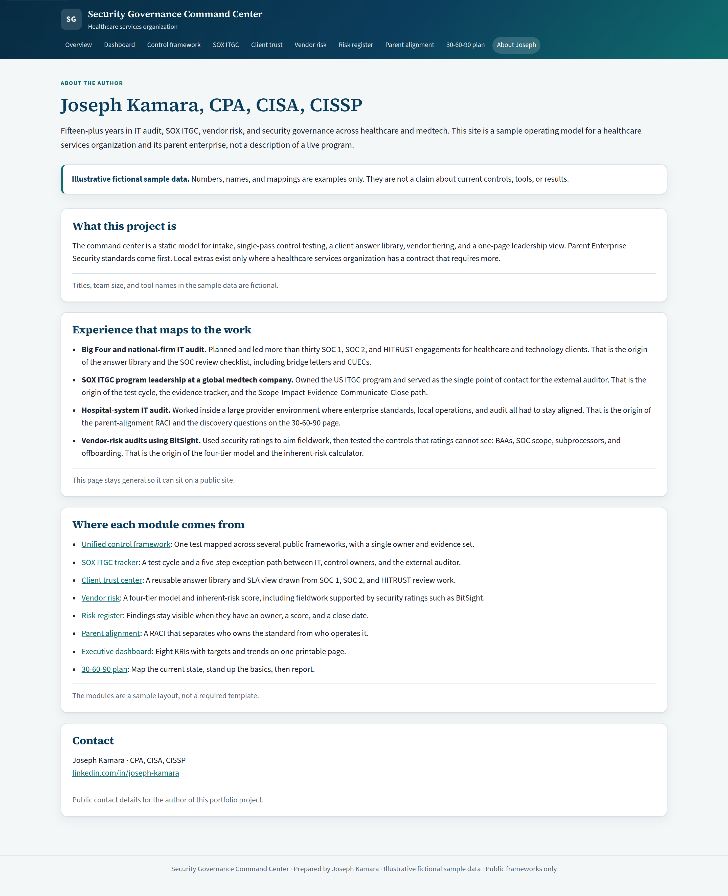

# Security Governance Command Center

A static Vite + React portfolio project by **Joseph Kamara, CPA, CISA, CISSP**. It is a sample security governance workspace: one control set, one risk register, and one page for leadership.

All numbers, vendors, clients, and findings are **illustrative fictional sample data**. They are built from public frameworks (SOX ITGC, SOC 2, HIPAA Security Rule, NIST CSF 2.0, ISO 27001:2022, and public HITRUST CSF numbering). HITRUST IDs should be checked against the licensed version before anyone treats them as an official crosswalk.

This repository is public-safe. It does not name real employers or clients. There are no API keys, tokens, or `.env` files. Source PDFs and private notes are excluded from git.

Public home: [github.com/Josephkamara/security-governance-command-center](https://github.com/Josephkamara/security-governance-command-center).

## Run locally

```bash
npm install
npm run dev
```

The app listens on [http://127.0.0.1:4521](http://127.0.0.1:4521).

```bash
npm run build    # writes static files to dist/
npm run preview  # serves dist/ on the same port
```

There is no backend and no secrets. Hash routing keeps GitHub Pages simple. The Pages root (`/#/`) is the short entry landing page. The 3-minute tour starts at `/#/dashboard?tour=1`.

## Publish to GitHub Pages

The workflow in `.github/workflows/pages.yml` builds `dist/` on each push to `main`. Set Pages to GitHub Actions (Settings → Pages → Source).

```bash
git remote add public https://github.com/Josephkamara/security-governance-command-center.git
git push -u public main
```

Do not copy private source documents or notes.

## What is in the command center

Primary nav:

| Route | Screen | Contents |
| --- | --- | --- |
| `/#/` | Overview | Hero line, Start the 3-minute tour, four cards |
| `/#/dashboard` | Leadership dashboard | Status line, decisions needed, indicators, collapsible thresholds and risk register |
| `/#/controls` | Controls & testing | One control mapped across six frameworks, plus SOX testing |
| `/#/vendor-risk` | Vendors | 4-tier model, inherent-risk calculator, intake, SOC checklist |
| `/#/client-trust` | Client security questionnaires | SIG / HECVAT library, SLA tracker, intake |
| `/#/about` | About | Background, first-90-days roadmap, enterprise standards alignment |

Older routes still resolve: `/#/sox` opens Controls & testing on the SOX tab, `/#/risk-register` opens the dashboard register, `/#/parent-alignment` and `/#/30-60-90` stay available from About.

## 3-minute tour

1. Leadership dashboard — status line, the decision, two indicators
2. Controls & testing — one control (A-05 MFA) traced across six frameworks
3. Vendors — the tier sets the work
4. Close — built to sit on existing tools

## Module walkthrough

**Leadership dashboard.** A one-line status computed from the sample indicators, the decision that needs a call, then the tiles. Thresholds and the full register sit in expanders.

**Controls & testing.** A searchable matrix that maps one owner and one evidence set across SOX ITGC, SOC 2, the HIPAA Security Rule, NIST CSF 2.0, ISO 27001:2022, and public HITRUST numbering, plus the SOX exception path.

**Vendors.** A four-tier model with an inherent-risk calculator, a seven-step intake, a SOC report checklist that includes bridge letters and CUECs, and a remediation list.

**Client security questionnaires.** A SIG / HECVAT-style answer library tied to controls, plus a turnaround SLA tracker and a due-diligence intake queue.

**About.** Background on Joseph Kamara and secondary links to enterprise standards alignment and the first-90-days roadmap.

## Screenshots

Illustrative sample screens from a local run. Open the live app for the interactive pieces (search, exception workflow, vendor scorer, print, tour). To regenerate screenshots after a UI change, run `npm i --no-save puppeteer-core` and `node scripts/capture-screenshots.mjs` with the preview server up.













## Design and quality notes

- Navy and teal palette, Source Serif headings, Source Sans body, plain language.
- Responsive layout with a mobile menu. Keyboard-visible focus and a skip link.
- Dashboard print stylesheet hides navigation and produces a board-style one-pager.
- No authentication, database, or environment variables.

## Author

Joseph Kamara, CPA, CISA, CISSP  
[linkedin.com/in/joseph-kamara](https://www.linkedin.com/in/joseph-kamara)
